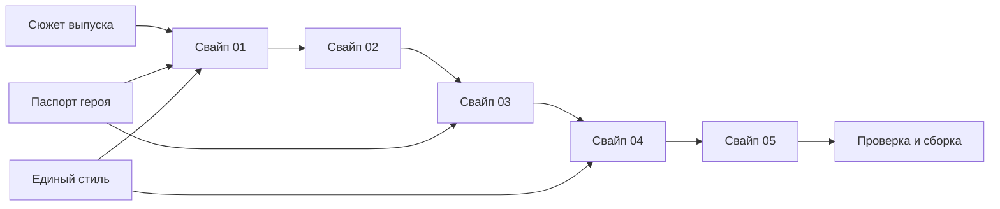

# Библиотека типовых графов AI Draftsman

В меню **«Проекты и граф» → «📚 Библиотека графов»** доступны **7 типизированных образцов**, сохранённых в таблице SQLite `studio_graph_templates`. Каждая схема показывает план работы, типы узлов, примерный текст и направленные связи. Выбери пример, посмотри диаграмму и нажми **«Создать по схеме»**. Новый проект получит собственные копии `studio_nodes` и `studio_edges`; библиотека не изменяется.

## Какую схему выбрать

| Название | Когда использовать | Схема |
|---|---|---|
| **Комикс — сюжет и 5 свайпов** (`comic_storyboard`) | Комиксы, уроки, кадры истории | Бриф + персонажи + стиль → слайд 1 → 2 → 3 → 4 → 5 → сборка |
| **Серия иллюстраций** (`illustration_series`) | Книга, соцсети, тематический набор | Задача + герой + стиль → три последовательные иллюстрации → сверка |
| **Предметная съёмка** (`product_catalog`) | Рекламная карточка товара | Фото/описание товара + стиль → главное фото → деталь → использование → экспорт |
| **Персонаж — ракурсы и эмоции** (`portrait_character`) | Создание постоянного героя | Паспорт + эталон + стиль → портрет → полный рост → эмоция → лист персонажа |
| **Техническая схема** (`technical_diagram`) | Архитектура ИТ, сеть, инженерная схема | ТЗ + компоненты + обозначения → топология → потоки → подсистемы → проверка |
| **Инфографика** (`infographic`) | Объяснение чисел/процессов для публикации | Факты + сетка → композиция → главный рисунок → блоки → верстка |
| **Концепт-арт среды** (`concept_art`) | Игровая локация, интерьер, архитектура | Мир + референсы + стиль → основной ракурс → вариация света / деталь → согласование |

Все схемы — **рабочие заготовки**, а не автоматический видеопроцессор. Узлы, тексты, координаты и связи можно редактировать. У новых узлов статус **«Черновик»**; генерация не запускается сама, пока не утверждён подходящий промпт и не нажата кнопка рендера.

## Пример: связный комикс из пяти свайпов

**Для KARATE LINUX:** открой этот универсальный шаблон, замени примерный бриф на конкретный урок, опиши Грепа Пайпа без бороды, кепку PL и очки, ROOT как пингвина и текущий пояс. Каждый свайп — свой узел `slide` и отдельная иллюстрация. Это отличается от **вариантов Seed**: варианты предлагают альтернативы одному и тому же кадру и не образуют последовательную историю.

Старый **«Шаблон Karate Linux»** на 24 урока оставлен отдельной кнопкой и не изменялся; библиотека универсальна и не подменяет его.

## Что означают типы узлов

| Тип | Назначение |
|---|---|
| `note`, `lesson` | Бриф, требования, история |
| `character` | Текстовый паспорт постоянного персонажа |
| `style` | Палитра, линия, художественные правила |
| `reference` | Описание образца/объекта, **не привязка PNG автоматически** |
| `prompt` | Детализация композиции и задачи для модели |
| `scene`, `slide` | Рисуемая сцена или отдельный свайп |
| `output` | Ручная проверка, сборка, экспорт |

**Ограничения текущей реализации:** направленные рёбра включают тексты предшествующих узлов в итоговый промпт (контекст до 16 предков и до 5 уровней); они **не запускают** вычисления последовательно, **не прикрепляют** сами по себе файлы изображений, **не обучают** LoRA, **не собирают** PNG в комикс и **не обеспечивают** неизменность лица. Для реального изображения-образца выбери `img2img` и загруженный PNG в панели генерации. Для технических схем и инфографики точные цифры, подписи, порты и связи следует проверять вручную; диффузионные модели способны их исказить.

## SQLite и безопасность

- Таблица `studio_graph_templates`: `id`, названия RU/EN, категория, описание, версия схемы, `definition_json`, `built_in`.
- При запуске отсутствующие встроенные шаблоны добавляются через `INSERT OR IGNORE`. Повторный запуск **не дублирует** шаблоны и **не переписывает** существующие данные или проекты.
- `GET /api/studio/templates` — список; `GET /api/studio/templates/<id>` — содержимое диаграммы; `POST /api/studio/projects` с `{"name":"...","template":"comic_storyboard"}` — создать копию.
- Встроенные определения и готовые проекты не являются запускаемыми кодовыми сценариями; добавление шаблона не потребляет GPU, VRAM или токены Ollama.
- Хранение **файлов референсов по SHA-256 и их привязок к каждому запуску** — отдельная задача; эта библиотека её пока не реализует.

## Работа через веб-интерфейс

Открой студию, перейди в **«Проекты и граф»**, раскрой **«Библиотека графов»**, выбери сценарий. Визуальная схема и пояснения покажут набор узлов, откуда идут связи и зачем нужен каждый узел. Создай проект, отредактируй бриф и сцены, сохрани, проверь «Итоговый промпт», утверди отдельный рисуемый узел, затем нажми «Генерировать».

Достаточно `git pull --ff-only` и перезапуска Flask через прежний `bash scripts/run.sh`. Новых systemd-служб, Python-пакетов и загрузок весов нет.
