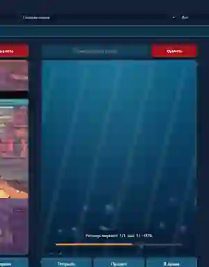
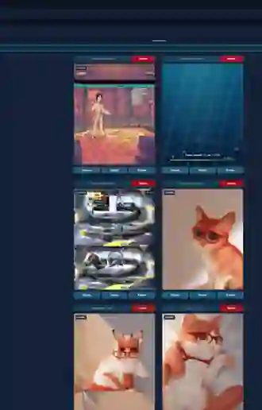
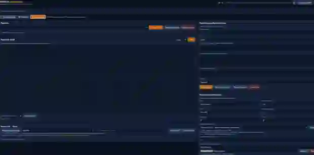
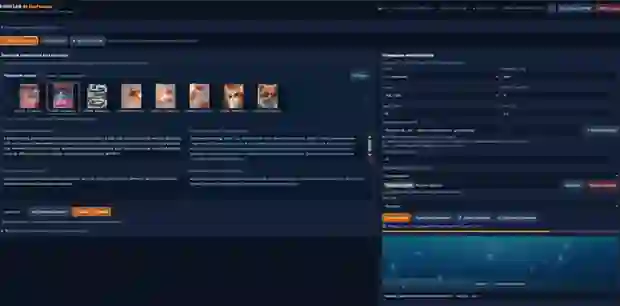

# AI Draftsman — real interface screenshots

These screenshots were supplied by the project author on **22 November 2026**, showing the application on a local NVIDIA RTX 3060 12 GB. These are **real application captures, not UI mockups**. The WebP files in GitHub are lightweight previews of the originals.

## Rerender progress inside a result card

The active result card displays animated bubbles, an actual generation stage and progress. Starting another GPU job is disabled while rendering.

## Model loading

The card displays model loading before inference begins.

## Result gallery

Large images, stable R-indexes, rerender/delete controls above, open/prompt/archive actions below.

## Project graph editor

Projects, graph nodes, prompts and render parameters, alongside the separate fast-generation mode.

## Fast image generation

An image shelf, stored positive/negative prompts with Russian translations, SDXL settings and real generation status.

## Design principles

AI Draftsman focuses on the **result as the primary unit of work**: image → saved prompt → rerender → separate saved output → archive. Large action targets improve precision, destructive actions require confirmation, and the local single-GPU policy avoids accumulating extra render jobs.

For a grounded industry comparison, see the [Russian showcase](SHOWCASE_RU.md) and the official documentation for [ComfyUI](https://github.com/Comfy-Org/ComfyUI), [AUTOMATIC1111](https://github.com/AUTOMATIC1111/stable-diffusion-webui), [InvokeAI](https://invoke.ai/features/gallery/) and [Leonardo AI](https://intercom.help/leonardo-ai/en/articles/8942360-how-to-generate-images-with-leonardo-ai). The comparison concerns workflow and interface organization, not benchmark superiority.

Previews are intentionally reduced in size. No generated PNG, database records, system services, or image models were changed.
