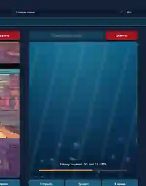
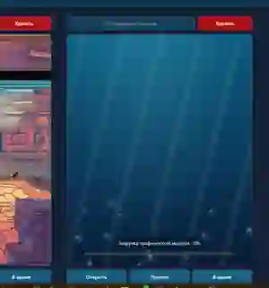
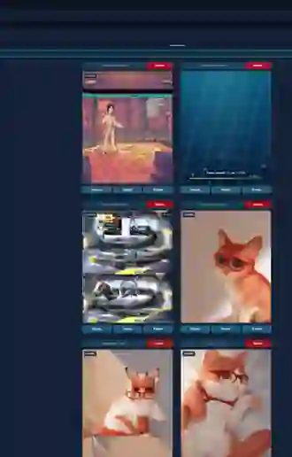
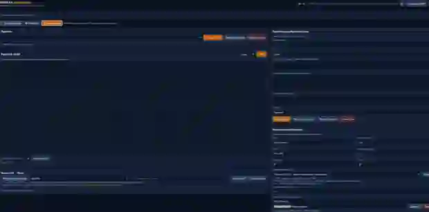
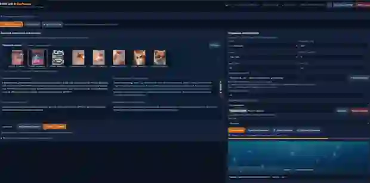

# AI Draftsman — реальные скриншоты интерфейса

Снимки от **22 ноября 2026 года** предоставлены автором проекта и демонстрируют фактическую работу AI Draftsman на локальном оборудовании с NVIDIA RTX 3060 12 ГБ. Это **не мокапы, не рендеры интерфейса и не изображения, изготовленные для рекламы**.

В GitHub хранятся облегчённые WebP-превью для экономии трафика и размера репозитория. Для профессиональной публикации и печати используются исходные PNG; их не следует восстанавливать из этих превью.

## 1. Повторная генерация внутри карточки

В исходной карточке появляется лёгкая анимация разноцветных пузырьков, статус рендера и прогресс. Сверху расположены крупные «Сгенерировать снова» и «Удалить», снизу — «Открыть», «Промпт», «В архив». Кнопки повторной генерации заблокированы до освобождения GPU.

## 2. Загрузка графической модели

После старта виден этап загрузки модели. Пока обработка продолжается, повторный запуск недоступен. Скриншот показывает начальную стадию, а не готовый результат.

## 3. Каталог результатов

Две крупные карточки в строке на широком экране. Постоянные индексы `R-0000XX`, оценка рисунка, отдельные действия и анимация только в занятой карточке. Слева сохраняется исходный результат, справа работает повторная генерация.

## 4. Проекты и графы

Встроенный граф сцен/узлов, создание проекта, параметры выбранного узла, промпты и SDXL-параметры. Система поддерживает два рабочих сценария: быстрый рисунок без графа и отдельный проектный редактор.

## 5. Быстрый рисунок

Лента последних эскизов, положительный и негативный промпты рядом с русскими переводами, настройки модели и живая индикация работы GPU. Генерация не требует создания проекта.

## Почему именно такой UX

Главная сущность системы — **результат**, а не техническая форма ввода. Карточка позволяет проследить цикл **рисунок → сохранённый промпт → новая генерация → отдельный результат → архив**. Крупные кнопки снижают риск случайного нажатия; удаление требует подтверждения браузера. На локальной RTX 3060 включена политика одного активного GPU-задания без очереди, чтобы не создавать бесполезные фоновые задания.

## Сравнение с актуальными инструментами

| Продукт | Известная сильная сторона | Отличие сценария AI Draftsman |
|---|---|---|
| [ComfyUI](https://github.com/Comfy-Org/ComfyUI) | Графы и переиспользуемые workflow; поддержка широкого набора моделей | Быстрый режим без обязательного графа и ориентация на управление карточками результатов |
| [AUTOMATIC1111 WebUI](https://github.com/AUTOMATIC1111/stable-diffusion-webui) | Богатые параметры, расширения, txt2img/img2img, PNG Info | Промпт, оценка, архив и перегенерация связаны с одним постоянным индексом рисунка |
| [InvokeAI](https://invoke.ai/features/gallery/) | Зрелые галерея, Canvas и управление генерациями | Минимальный локальный интерфейс, не претендующий на замену профессионального Canvas |
| [Leonardo AI](https://intercom.help/leonardo-ai/en/articles/8942360-how-to-generate-images-with-leonardo-ai) | Облачные модели, стили, референсы и коллекции | Управление собственным GPU без обязательного облачного рендеринга |

Сравнение описывает **принципы организации интерфейса**, а не утверждает превосходство в качестве генерации, скорости или наборе профессиональных функций. AI Draftsman пока не заменяет инструменты редактирования масок, регионального контроля и комплексного обучения персонажей.

### Примечание

- Реальные скриншоты сжаты и уменьшены для документации. Результаты в пользовательской SQLite и файлы изображений в `data/jobs/` не изменялись.
- Номера результатов, содержимое изображений и проценты прогресса на скриншотах взяты из конкретных пользовательских сессий; это не гарантия одинакового времени или качества на другом оборудовании.
- Документация не требует установки библиотек, изменения Flask или перезапуска GPU worker.
